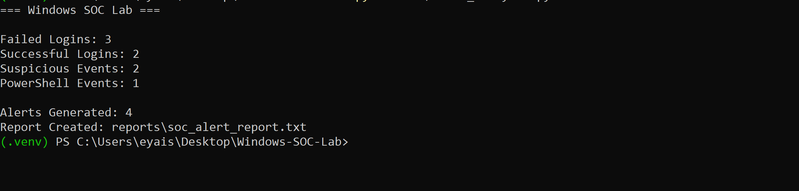
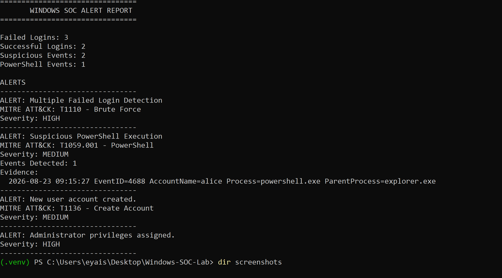
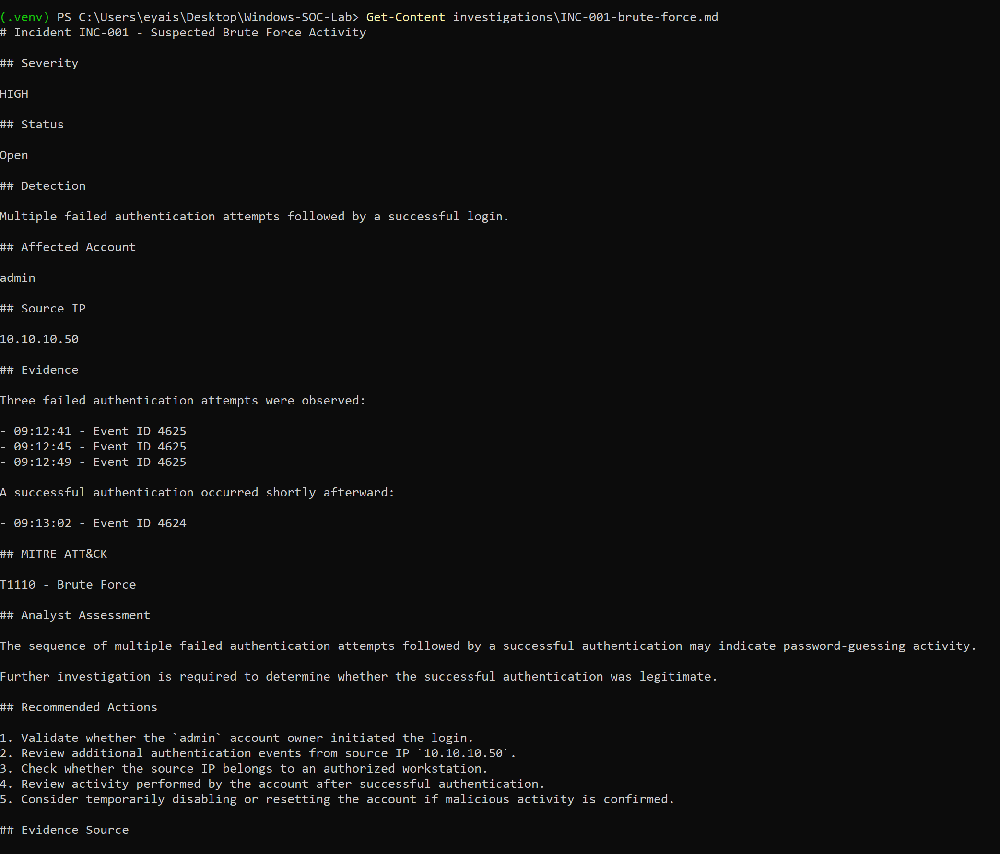
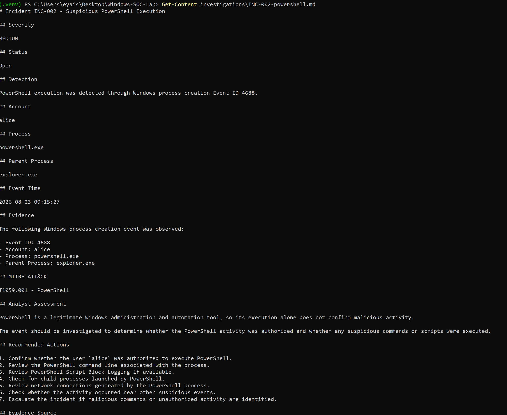
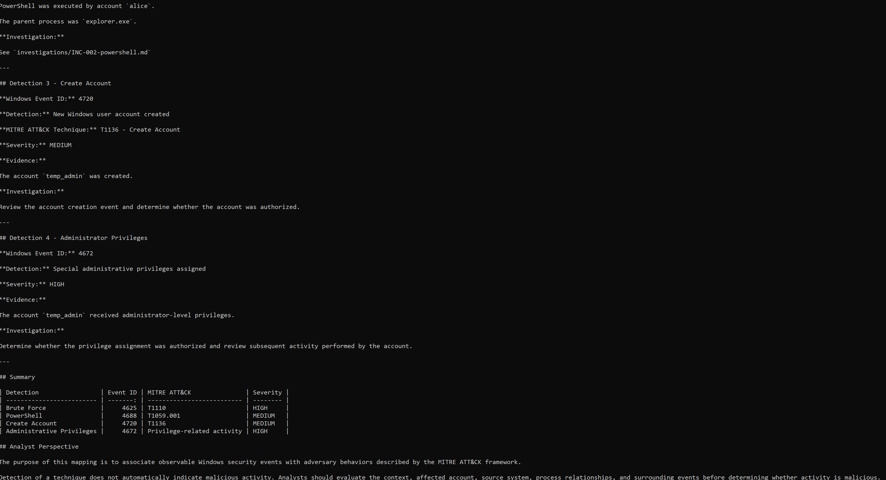

# Windows SOC Lab

A beginner SOC project where I analyze sample Windows Security events, write detection rules, generate alerts, and document each alert as an incident investigation mapped to MITRE ATT&CK.

The goal was to practice the core loop of a SOC analyst's job: **read the logs, detect suspicious activity, triage the alert, and write up the findings.**

---

## Overview

The lab uses a small sample log (`logs/security_events.log`) that contains a realistic attack story built from Windows Security Event IDs:

1. Three failed logons to the `admin` account from `10.10.10.50`, followed by a successful logon from the same IP
2. PowerShell launched by the user `alice`
3. A new local account, `temp_admin`, is created
4. `temp_admin` is then assigned administrator privileges

A Python script (`src/event_analyzer.py`) reads the log, applies detection rules defined in YAML, and writes an alert report. I then investigated each alert and documented it in an incident write-up with evidence, an analyst assessment, and recommended response actions.

```text
Sample Windows events -> Detection rules -> Alerts -> Investigation -> MITRE ATT&CK mapping -> Response recommendations
```

---

## Detections

| Detection | Windows Event ID | MITRE ATT&CK | Severity | Logic |
|---|---|---|---|---|
| Brute force | 4625 (failed logon) | T1110 – Brute Force | High | Alerts when failed logons reach the threshold set in the rule (3) |
| PowerShell execution | 4688 (process creation) | T1059.001 – PowerShell | Medium | Alerts on any `powershell.exe` process creation |
| Local account creation | 4720 (user account created) | T1136.001 – Create Account: Local Account | Medium | Alerts on any new user account |
| Privileged logon | 4672 (special privileges assigned) | Not mapped | High | Alerts when special/admin privileges are assigned |

Each YAML rule in `detections/` records the rule name, severity, Event ID, ATT&CK technique, and the triage steps an analyst should follow when it fires.

---

## Incident Investigations

Each alert has a written investigation in `investigations/`, structured like a SOC ticket:

| Incident | Summary |
|---|---|
| [INC-001](investigations/INC-001-brute-force.md) | Suspected brute force: 3 failed logons, then a successful logon to `admin` from the same IP |
| [INC-002](investigations/INC-002-powershell.md) | PowerShell started by `alice` from `explorer.exe`; needs command-line review before deciding if it's malicious |
| [INC-003](investigations/INC-003-account-creation.md) | New local account `temp_admin` created, then given admin privileges; possible persistence |

Every write-up covers severity, status, evidence with timestamps, ATT&CK technique, analyst assessment, and recommended actions. I also tried to avoid jumping to conclusions. For example, INC-002 notes that PowerShell is a normal admin tool and that the event alone doesn't prove malicious activity.

The full mapping of detections to ATT&CK techniques is in [`docs/mitre_attack_mapping.md`](docs/mitre_attack_mapping.md).

---

## Skills Demonstrated

- **Windows log analysis:** reading and interpreting Security Event IDs 4624, 4625, 4672, 4688 and 4720
- **Detection engineering basics:** writing detection rules with thresholds, severities and response steps
- **Alert triage:** reviewing the evidence behind each alert and judging whether it needs escalation
- **Incident documentation:** writing clear investigation reports with evidence, assessment and next steps
- **MITRE ATT&CK:** mapping observed activity to tactics and techniques
- **Scripting:** using Python to parse logs and automate alert reporting

---

## Tools and Technologies

- Python 3 and PyYAML
- YAML (detection rules)
- Windows Security Event Logs (event IDs and fields)
- MITRE ATT&CK framework
- PowerShell (terminal)
- Git and GitHub

---

## Getting Started

Requires Python 3. Run the commands from the project's root folder, because the script uses relative paths.

```powershell
git clone https://github.com/Eyaisu1463/windows-soc-lab.git
cd windows-soc-lab

python -m venv .venv
.\.venv\Scripts\Activate.ps1      # Mac/Linux: source .venv/bin/activate

pip install -r requirements.txt
python src/event_analyzer.py
```

### Example output

```text
=== Windows SOC Lab ===

Failed Logins: 3
Successful Logins: 2
Suspicious Events: 2
PowerShell Events: 1
Account Creation Events: 1

Alerts Generated: 4
Report Created: reports/soc_alert_report.txt
```

The full alert report, including evidence for each alert, is saved to [`reports/soc_alert_report.txt`](reports/soc_alert_report.txt):

```text
ALERT: Multiple Failed Login Detection
MITRE ATT&CK: T1110 - Brute Force
Severity: HIGH
--------------------------------
ALERT: Windows Account Creation Detection
MITRE ATT&CK: T1136.001 - Create Account - Local Account
Severity: MEDIUM
Events Detected: 1
Evidence:
  2026-08-23 09:17:33 EventID=4720 AccountName=temp_admin Action=UserCreated
```

---

## Project Structure

```text
windows-soc-lab/
├── detections/          # YAML detection rules
│   ├── account_creation_detection.yml
│   ├── brute_force_detection.yml
│   └── powershell_detection.yml
├── docs/
│   └── mitre_attack_mapping.md
├── investigations/      # Incident write-ups
│   ├── INC-001-brute-force.md
│   ├── INC-002-powershell.md
│   └── INC-003-account-creation.md
├── logs/
│   └── security_events.log
├── reports/
│   └── soc_alert_report.txt
├── screenshots/
├── src/
│   └── event_analyzer.py
├── requirements.txt
└── README.md
```

---

## Screenshots

| | |
|---|---|
| Analyzer run |  |
| Alert report |  |
| Brute force investigation |  |
| PowerShell investigation |  |
| MITRE ATT&CK mapping |  |

---

## Limitations

This is a learning lab, not a production detection tool:

- The log is a small, hand-built sample in a simplified `key=value` format, not a live export from Windows Event Viewer.
- The brute-force rule counts all failed logons in the file. It doesn't group them by account or source IP or use a time window.
- The PowerShell rule flags every PowerShell launch, so in a real environment it would be noisy without command-line analysis.
- Event ID matching is written in the Python script; the YAML rules supply the name, severity, ATT&CK technique and threshold.
- The investigations were written by me after reviewing the alerts; they are not generated automatically.

## Next Steps

- Group failed logons by account and source IP within a time window, and correlate them with a following successful logon
- Read real `.evtx` logs exported from a Windows VM
- Forward events to a SIEM (such as Splunk or Wazuh) and rebuild these detections as SIEM queries
- Add Sysmon to capture PowerShell command lines and network connections
- Convert the YAML rules to the Sigma format
